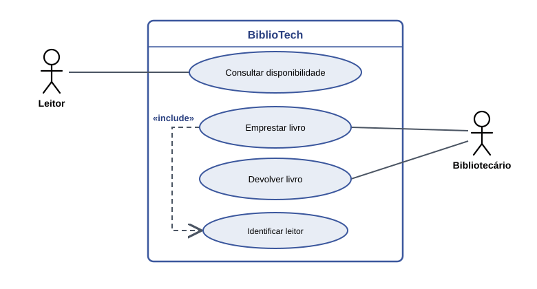
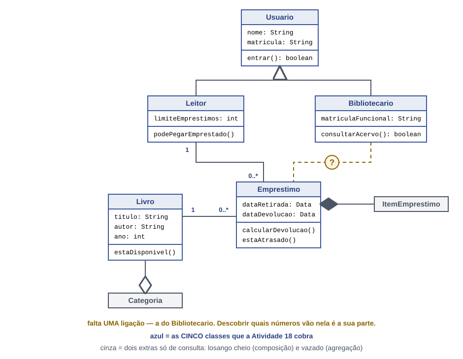

# 🎯 BiblioTech — Gestão Bibliotecária

## Seção 1: Apresentação do Projeto & Visão Geral
O **BiblioTech** é um sistema projetado para gerenciar operações essenciais de uma biblioteca, automatizando a consulta de disponibilidade, o registro de empréstimos, devoluções e a identificação dos usuários leitores.

- **Cliente:** Bibliotecas escolares, universitárias ou comunitárias.
- **Problema:** Controle manual passível de erros na entrega, falta de verificação rápida do acervo e ausência de histórico centralizado de empréstimos.
- **Público-alvo:** Leitores (estudantes/comunidade) e Bibliotecários (gestores do acervo).




---

## Seção 2: Histórias de Usuário (HU) e Requisitos Funcionais (RF)

### Histórias de Usuário (HU)
| ID | Como [Papel] | Eu quero [Ação] | Para que [Benefício] |
|---|---|---|---|
| HU01 | Leitor | Consultar a disponibilidade de um livro | Saber se posso realizá-lo o empréstimo imediatamente |
| HU02 | Bibliotecário | Registrar o empréstimo de um livro para um leitor | Garantir que a obra esteja associada a um leitor identificado |
| HU03 | Bibliotecário | Registrar a devolução de um livro | Atualizar o status da obra e verificar devoluções em atraso |

### Requisitos Funcionais (RF)
| ID | Descrição | Origem / Veio da |
|---|---|---|
| RF01 | O sistema deve permitir a consulta da disponibilidade dos livros do acervo. | HU01 |
| RF02 | O sistema deve permitir ao bibliotecário registrar empréstimos vinculando o leitor ao livro. | HU02 |
| RF03 | O sistema deve obrigatoriamente identificar o leitor ao realizar um empréstimo («include»). | HU02 |
| RF04 | O sistema deve registrar a devolução e calcular eventuais atrasos. | HU03 |
| RF06 | O sistema deve emitir um comprovante/notificação digital de renovação ou devolução. | Solicitado pelo cliente / Regra de Negócio |

---

## Seção 3: Decisão da Ligação Bibliotecario–Emprestimo

- **Multiplicidade definida:** `Bibliotecario (1) <---> (0..*) Emprestimo`
- **Justificativa:** Cada registro de empréstimo deve ser processado e atrelado a exatamente **1** Bibliotecário responsável pela operação no sistema. Por outro lado, um Bibliotecário pode realizar nenhum (**0**) ou múltiplos (*****) empréstimos ao longo da sua rotina de trabalho.

---

## Seção 4: Diagrama de Classes (Mermaid)

```mermaid
classDiagram
    class Usuario {
        +String nome
        +String matricula
        +entrar() boolean
    }

    class Leitor {
        +int limiteEmprestimos
        +podePegarEmprestado()
    }

    class Bibliotecario {
        +String matriculaFuncional
        +consultarAcervo() boolean
    }

    class Livro {
        +String titulo
        +String autor
        +int ano
        +estaDisponivel()
    }

    class Emprestimo {
        +Data dataRetirada
        +Data dataDevolucao
        +calcularDevolucao()
        +estaAtrasado()
    }

    Usuario <|-- Leitor
    Usuario <|-- Bibliotecario
    Leitor "1" -- "0..*" Emprestimo : realiza
    Bibliotecario "1" -- "0..*" Emprestimo : registra
    Livro "1" -- "0..*" Emprestimo : composto por

## 6. Como executar

No Codespace, dentro da pasta `bibliotech`:

```bash
javac *.java
java TesteRequisitos
java TelaBiblioteca

TesteRequisitos confere os requisitos no terminal. TelaBiblioteca abre a janela na área de trabalho do Codespace (porta 6080).
7. Requisitos e verificações

#
	

Onde está no código
	

Como verifico

RF01
	

Biblioteca.cadastrarLivro()
	

TesteRequisitos: 1 verificação RF01

RF02
	

Biblioteca.cadastrarLeitor()
	

TesteRequisitos: 1 verificação RF02

RF03
	

Biblioteca.buscarLivro() e Livro.estaDisponivel()
	

área do acervo na janela | TesteRequisitos: 2 verificações RF03

RF04
	

Biblioteca.devolver(), que chama Emprestimo.registrarDevolucao()
	

botão Devolver | TesteRequisitos: 3 verificações RF04

RF05
	

Biblioteca.emprestar(), que chama Emprestimo.realizarEmprestimo()
	

botão Emprestar | TesteRequisitos: 5 verificações RF05

RF06
	

(o seu RF: onde está, ou “ainda não implementado”)
	

(a verificação, ou “sem verificação”)
8. O que o BiblioTech ainda não faz

    HU05: ver os empréstimos atrasados. O empréstimo ainda não tem prazo.

    RNF02: qualquer pessoa que abre a janela pode emprestar e devolver; não há login de bibliotecário.

    Cadastrar livro pela janela: hoje o cadastro está no main de TelaBiblioteca.

    Guardar os dados: ao fechar o programa, os empréstimos se perdem.

    ## Persistência de Dados

Foi utilizado o banco de dados bibliotech, com a tabela livros, que armazena o identificador, o título, o autor e o ano de publicação de cada livro.
Classe Conexao

A classe Conexao é responsável por estabelecer a conexão entre a aplicação Java e o banco de dados MariaDB, utilizando JDBC.

As credenciais são obtidas por meio das variáveis de ambiente DB_USER e DB_PASSWORD, evitando deixar a senha diretamente no código-fonte.

Para configurar as variáveis no terminal Linux ou GitHub Codespaces:

export DB_USER="root"
export DB_PASSWORD="SUA_SENHA"

Classe LivroDAO

A classe LivroDAO é responsável pelas operações de acesso e manipulação dos dados dos livros no banco de dados.

Foram implementados os seguintes métodos:

    adicionarLivro(): cadastra um novo livro com título, autor e ano de publicação.
    atualizarLivro(): modifica os dados de um livro com base em seu identificador (id).
    excluirLivro(): remove um livro do banco de dados utilizando seu identificador.

Testes de persistência

Os testes são realizados pela classe TesteLivroDAO, que verifica o funcionamento das operações de inserção, atualização e exclusão.

A consulta abaixo permite verificar os registros armazenados:

SELECT * FROM livros;

Após cadastrar três livros, foi realizada a atualização de um registro e a exclusão de outro. Em seguida, o programa Java foi encerrado e a consulta ao banco foi executada novamente para verificar se os dois livros restantes continuavam armazenados.

Também foi previsto um teste com um identificador inexistente (999999), para verificar se os métodos atualizarLivro() e excluirLivro() retornam false quando nenhum registro é encontrado.
Como executar os testes

Com o MariaDB em execução, as variáveis de ambiente configuradas e o driver JDBC disponível na pasta lib/, execute os comandos no terminal do projeto:

Compilar:

javac -cp ".:lib/*" Conexao.java LivroDAO.java TesteConexao.java TesteLivroDAO.java